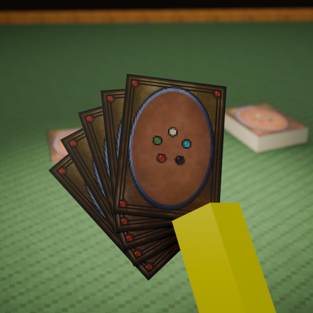
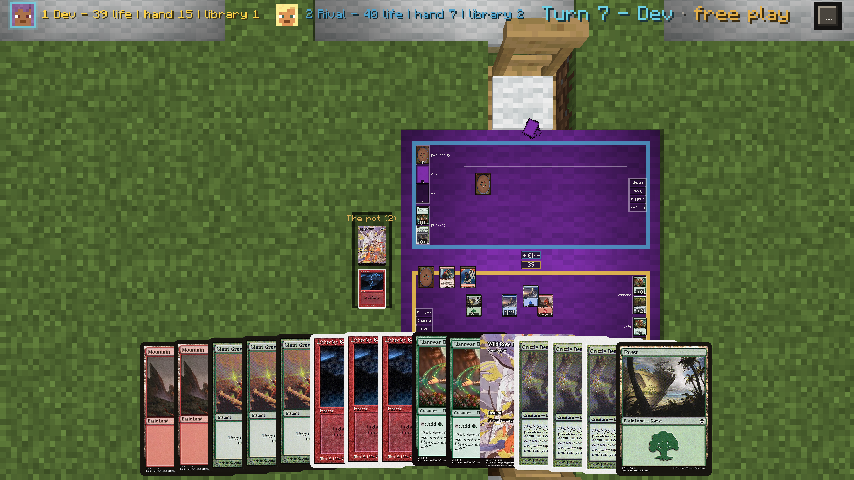
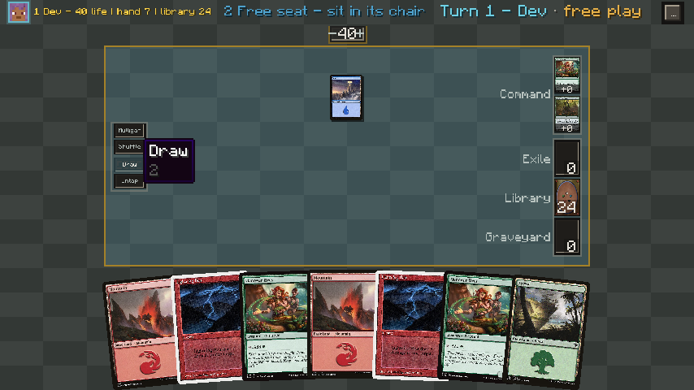
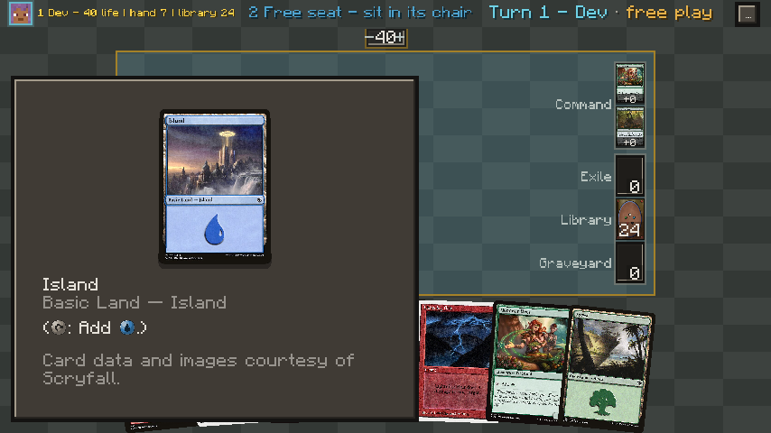
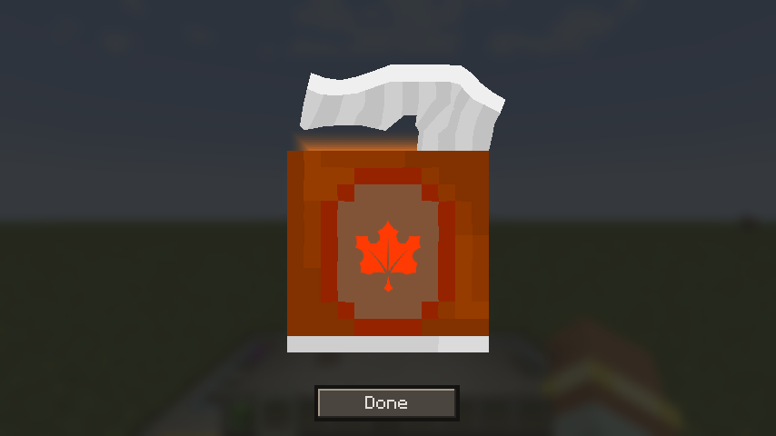
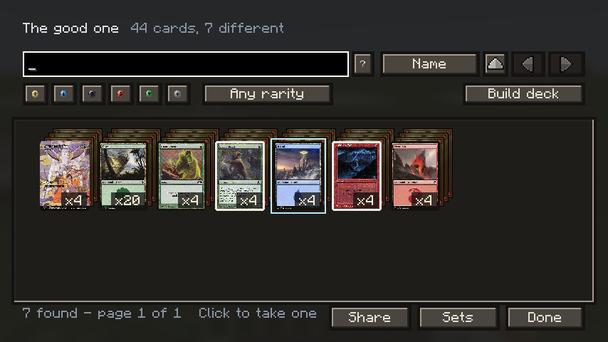
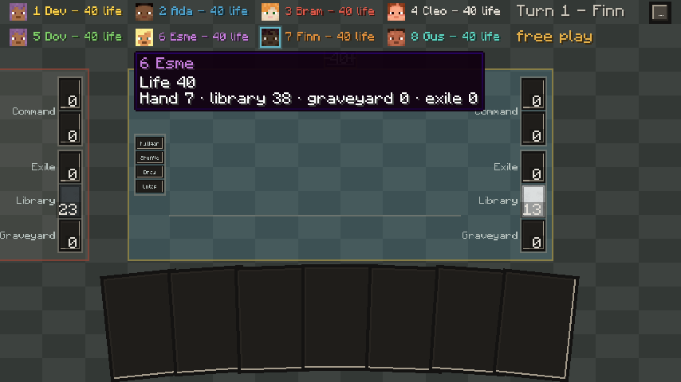
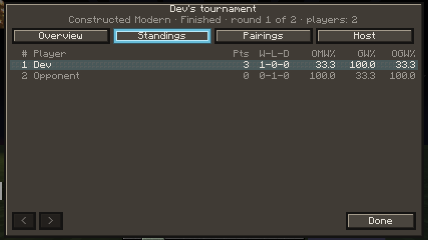
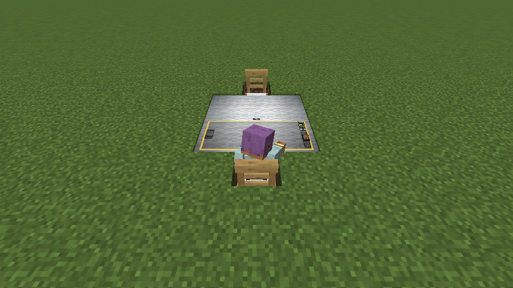

<p align="center"></p>

# Gathering

Sit down at a table in Minecraft and play a card game with real decks: real cards, a hand only you
can see, up to eight players at one board, and no rules engine. You move the cards and you decide
what happens.

> **Unofficial Fan Content.** Not approved or endorsed by Wizards of the Coast. Portions of the
> materials used are property of Wizards of the Coast. ©Wizards of the Coast LLC.
>
> NOT AN OFFICIAL MINECRAFT PRODUCT. NOT APPROVED BY OR ASSOCIATED WITH MOJANG OR MICROSOFT.
>
> Card data and images come from [Scryfall](https://scryfall.com). No card images ship inside
> this mod; each player's game fetches and caches its own.



| | |
|---|---|
| **Minecraft** | 1.21.1 |
| **Loaders** | NeoForge 21.1.1+, or Fabric Loader 0.15.11+ with Fabric API 0.102.0+ |
| **Players** | Singleplayer, LAN, or a dedicated server |
| **Needs** | An internet connection the first time a card is looked up |
| **License** | MIT |

## Features

- **A table you build.** Three wool over planks makes a table three blocks across that seats two.
  Push up to four together in a line and they become one table for eight. Tables, chairs, shop
  counters, Scorekeeper's Desks, collections and display cases come in every wood, and tables and
  chairs also in cobblestone, polished blackstone and crying obsidian.
- **Real cards.** Every card is a real printing, with its art and rules text, looked up on
  Scryfall. Hold **Left Alt** over any card to read it in full; tilt a foil to catch the light.
- **Hidden information that is really hidden.** Your hand and the order of your library are yours.
  The identity of a hidden card is never sent to a player who is not entitled to see it, so a
  modified client has nothing to read. Shuffles use a seed that is never logged, sent or shown.
- **No rules engine, ever.** The mod moves cards, keeps numbers and shows things. It never decides
  whether a play is legal. The game log records who did what, by name, so the table can check.
  Before a formatted game, a deck check says what is not legal, and you can still play it.
- **Everything a table needs.** Dice up to twenty sides, a coin and the planar die, all rolled by
  the server and written in the log. Life, counters, commander damage and tax, tokens, emblems,
  blank cards to write on, the four dungeons. Show your hand to one player or to everyone. Talk to
  the table with your chat key. Undo a misclick.
- **Two ways to see the board.** A table opens on the table block itself, with the cards lying on
  it, which is what everyone standing around it sees. Press **V** for a flat board that fills the
  screen; the choice is remembered. Anyone nearby can watch a game.
- **Collecting.** Booster packs turn up in loot. A shop counter in a village gives a villager the
  job of selling boosters, display boxes, Commander decks and cases for Mana Coins, which are found
  in chests. Packs are collated from the print sheets each set was really sold with. Tear a pack
  open, file the cards into a collection, search it (`t:elf c:g mv<=3`), and build a deck from
  what you own.
- **Drafts, trades and loaner decks.** Draft with four to eight players, or a cube. Trade with
  another player. A server can lend decks to anyone who sits down without one, and can allow
  playing for keeps, which happens only when everyone at the table agrees.
- **Tournaments.** A Scorekeeper's Desk runs a Swiss event: sign-up, check-in, pairings, a round
  clock, standings, a top-eight cut and prizes.
- **Replays.** Watch a finished game back, step by step.
- **Twelve looks.** Every panel and button is a texture, so a resource pack can restyle all of it.
  Choose a look in **Options > Video Settings**.
- **Create, on NeoForge.** With Create installed, a Display Link writes a desk's standings,
  pairings or clock, or a table's life totals, onto a board, and a Deployer tears boosters open.
  With Create Aeronautics, tables can be built on its moving structures.

## Screenshots

| | |
|---|---|
|  |  |
| The flat board | Reading a card |
|  |  |
| Tearing a pack open | A collection |
|  |  |
| Eight at one table | A tournament's standings |
|  | |
| Sitting at a table | |

## Requirements

- **Minecraft 1.21.1** and Java 21, which the Minecraft launcher provides.
- **NeoForge 21.1.1 or newer** in the 21.1 line, **or** **Fabric Loader 0.15.11 or newer** with
  **Fabric API 0.102.0+1.21.1 or newer**.
- On a server, the mod on the server and on every client, at the same version.
- An internet connection. The server looks cards up on Scryfall and reads set data from MTGJSON;
  each client downloads the card images it shows. A card seen once works offline after that.

## Installation

1. Download the jar for your loader from CurseForge: [search for Gathering](https://www.curseforge.com/minecraft/search?search=gathering).
2. Put it in the `mods` folder. On Fabric, put Fabric API there too.
3. On a server, do the same on the server and on every player's game.

## Getting started

**Build a table.** Craft a table from three wool on top, a row of three planks under them, and a
plank at each bottom corner. Any wool works; the planks decide the wood. Craft a chair from a stick
in the top-left corner, three planks across the middle and a stick in each bottom corner. Place a
chair at the middle of the table's edge, facing it, and another opposite. Push tables together end
to end for more seats: two seat four, four seat eight.

**Get a deck.** On a server that collects (the default):

- Sit at a table and choose **Learn the controls**. Finish the six-step lesson and pick two
  colors, and you are given two Jumpstart boosters, one of each.
- Right-click a booster to open it and drag across the top to tear it. File the cards into a
  **Collection** block, and build a deck from it with **Build deck**.
- Pick up a card and right-click it onto another to start a deck by hand.
- If the server lends decks, sit down empty-handed and borrow one.

On a server that imports decks, type `/gathering import` with nothing after it, paste a decklist or
an Archidekt link, and press **Import**. Moxfield, Archidekt, MTG Arena, MTGO and plain `1 Sol Ring`
lists all work. Operators can always import.

**Sit down and play.** Right-click the chair to sit. Choose a format and how many games, or free
play, and press **Start**. Choose a deck from your inventory and it goes down shuffled, with seven
cards in your hand. Drag cards to play them, right-click a card or the felt for everything else, and
crouch to get up. The **?** on the board opens the guide.

**The keys at the table.** The table's actions and the read key can be changed in **Options >
Controls**, under Gathering. A key you give a table action does that action at the board, even if
it is also your chat key or F1.

| Key | Does |
|---|---|
| 0 | Pass the turn |
| 1 | Untap everything |
| 2 | Draw a card |
| 3, 4, 5, 6 | Scry, mill, reveal the top card, surveil |
| 7, 8, 9 | Send the card you point at to exile, to the graveyard, or to the bottom of your library in no order |
| Q, E | Untap, tap the card you point at |
| R | Shuffle your library |
| F | Turn a card over |
| / | Find any action by name |
| L | Show the log |
| Home | Show the whole table |
| Left Alt (hold) | Read the card you point at |
| V | Switch between the table block and the flat board |
| F1 | List every key |
| Mouse wheel, WASD or arrows | Zoom and move the view |
| Your chat key | Talk to the table |

## For server owners

Settings live in `config/gathering-server.toml`, written on first start with every setting at its
default and a sentence explaining each. `/gathering config` lists them, and an operator can change
one in game with `/gathering config <setting> <value>`.

**Collection mode or import mode.** As it ships, collecting is on and only operators can import:
cards are found, opened, bought and traded, so a pack is worth opening. For a play server where
everyone brings their own decklist, set `import.allow_all_players = true`, and
`modes.collection_enabled = false` if you want no packs at all. Or apply a profile:

```
/gathering profile                  # what there is
/gathering profile imported         # what it would change
/gathering profile imported apply   # change it
/gathering profile restore          # put the file back as it was
```

`casual` is cheap packs and recent sets; `long_run` makes a collection a long project; `imported`
is decks brought from outside. A profile only writes ordinary settings and never touches anything a
player owns.

**Settings worth knowing.**

| Setting | Default | What it does |
|---|---|---|
| `collection.pack_loot_sources` | all four | Where packs drop: `structures`, `mobs`, `fishing`, `archaeology` |
| `collection.loot_sets` | `["all"]` | Which sets packs come from: `all`, `current`, `recent`, or set codes |
| `collection.sealed_price_item` | `gathering:mana_coin` | What the card shop takes |
| `collection.village_shop_weight` | `20` | How often villages build a card shop; `0` builds none |
| `collection.starter_set` | `j25` | The starter boosters after the lesson; empty turns them off |
| `modes.replays` | `participants` | Who may watch a casual game back: `participants`, `public` or `off` |
| `ante.enabled` | `false` | Playing for keeps, only ever with every player's agreement |
| `cards.bulk_data` | `true` | Keep a copy of Scryfall's card file on the server, about 110 MB on disk |

**Loaner decks.** Decklists in `config/gathering-loaners/`, one file each, are decks any table can
lend. One sample deck is written on first start. `/gathering loaners reload` reads the folder again.

**Commands.** `/gathering table info` says what the server thinks is at the table you look at.
`/gathering table end` ends its game. `/gathering replay` lists finished games. Operators also have
`/gathering pack give <set>` and `/gathering coverage`.

**Cost.** Card lookups are batched, rate-limited, cached on disk and done off the main thread. With
the bulk file, ordinary play makes no card requests at all.

## Building from source

Gradle needs **Java 21**. The first build downloads and decompiles Minecraft, which takes several
minutes once.

```bash
./gradlew build                          # both loaders' jars, and the unit tests
./gradlew :core:test                     # the unit tests alone, in seconds
./gradlew :neoforge:runGameTestServer    # NeoForge's in-world tests
./gradlew :fabric:runGametest            # Fabric's in-world tests
./gradlew verify                         # all of it, with data generation
./gradlew :neoforge:runClient            # play it; :fabric:runClient for Fabric
```

The jars land in `neoforge/build/libs` and `fabric/build/libs`. The source is four modules: `core`
is pure Java with no Minecraft on its classpath, `common` is the mod with no loader imports, and
`neoforge` and `fabric` are the two loaders' entry points. The build enforces both fences.

**Some interface sprites are third-party and are not in this repository.** The arrows, the loading
spinner, the progress bars and the boxes of pips in every look, and the frames the Ember, Arcane,
Verdant and Royal looks are built around, are BDragon1727's pixel art, used under his terms (see
[CREDITS.md](CREDITS.md)). The released jars include them. A jar built from this source draws
Minecraft's magenta-and-black missing-texture pattern in their place, and the four framed looks use
the Basic look's panel. The build, the tests and everything else in the game are unaffected.
[docs/third-party-sprites.txt](docs/third-party-sprites.txt) lists the files.

## AI disclosure

Gathering was developed with substantial help from generative AI. Most of its source code was written with Anthropic's Claude, and a share of its textures, models and design work was produced with Claude and OpenAI's ChatGPT, including the project icon, which is a Blender render set up by Claude. All of it was directed, curated and playtested by MeekTheSneak, who maintains the project. Interface sprites derived from BDragon1727's pixel UI packs are credited in [CREDITS.md](CREDITS.md).

## License and credits

The mod's code is [MIT](LICENSE). It contains no Wizards of the Coast assets and no Scryfall data.
[CREDITS.md](CREDITS.md) lists the art and the data sources the mod relies on, and
[CHANGELOG.md](CHANGELOG.md) what each release changed.
